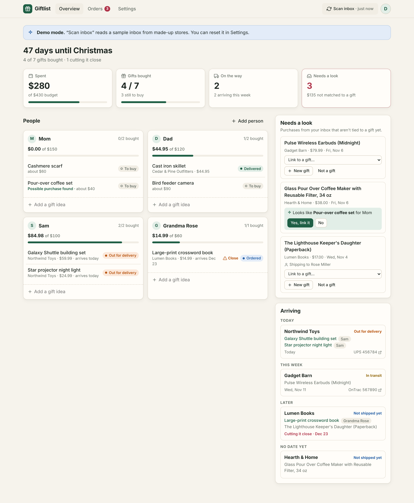

# Giftlist

A Christmas list tracker. You add the people you're buying for and the gifts you plan to get. Giftlist reads your order and shipping emails, fills in order numbers, prices, tracking and delivery dates, and matches each purchase to the gift it's for. One dashboard shows what you've ordered, what you've spent on each person, which packages are on the way, and what might arrive too late.



## What it does

- **Gift list by person.** Each person gets a budget, a spend bar and their gifts, with a status for each gift: To buy, Ordered, Shipped, Out for delivery, Delivered, Wrapped.
- **Reads your inbox.** After you sign in with Google, a scanner searches Gmail (read-only) for order, shipping and delivery emails. Claude Haiku pulls out the store, order number, products, prices, tracking numbers and delivery dates.
- **Matches purchases to gifts.** Clear matches are linked automatically. Likely matches are suggested for a one-click "Yes, link it". Everything else lands in **Needs a look**, where you can link it to a gift, add it as a new gift (the shipping name pre-selects the person when it matches), or mark it "Not a gift".
- **Tracks packages.** Arrivals are grouped by Today, Tomorrow, This week and Later, with carrier tracking links. Status updates come from later emails ("Out for delivery", "Delivered"). Packages expected after the gift day, or within 3 days of it, are flagged.
- **Keeps up on its own.** A cron trigger checks for new mail every 30 minutes. The "Scan inbox" button in the header catches up on demand.
- **Covers what email can't.** You can record in-store purchases, enter a tracking number by hand, mark gifts "I have it" or "Wrapped", and hide stores you never buy gifts from (groceries and so on).

## How it's built

| Piece | What it uses |
| --- | --- |
| API, sign-in, scanner | One Cloudflare Worker ([Hono](https://hono.dev)), in `worker/` |
| Database | Cloudflare D1 (SQLite), schema in `migrations/` |
| Dashboard | React, built by Vite and served as Workers static assets, in `src/` |
| Email reading | Gmail API with the `gmail.readonly` scope |
| Extraction | Claude Haiku 5.5 (`claude-haiku-5-5`) via the Anthropic SDK, using structured outputs |
| Background scans | Workers cron trigger (`*/30 * * * *`) |

How a scan works (`worker/scan/`):

1. `gmail.ts` searches for transactional email since the season start date (subjects like "order", "shipped", "delivered", plus Gmail's Purchases category; Promotions and Social are skipped). It only reads messages it hasn't seen before.
2. `email-text.ts` turns each email into plain text, keeping links that look like tracking links, since many tracking numbers only appear in a URL.
3. `extract.ts` sends the text and your gift list to Claude Haiku at low effort. The response is constrained to a JSON schema: email kind, store, order number, line items with prices, tracking numbers with status, delivery date, ship-to name, and a suggested gift for each product.
4. `apply.ts` merges the result into orders, shipments and order lines. Order and tracking numbers are kept only if they appear word-for-word in the email, so a made-up number never reaches your dashboard. Orders are matched by order number first, then by tracking number, so "shipped" and "delivered" emails attach to the right order even without an order number. Statuses only move forward.
5. Matching: a high-confidence model match is linked automatically. Medium-confidence model matches and fuzzy name matches (`matching.ts`) become suggestions you confirm.

Scans run in small batches (2 emails per request by default, more on Workers Paid). The dashboard calls the scan endpoint in a loop until the inbox is caught up, and the cron trigger picks up new mail.

The scanner is built not to get stuck or lose mail:

- Each email's results are saved in one transaction together with the record that it was read, so an email is never half-applied.
- Rate limits, outages and setup problems (bad API key, unknown model) stop the scan and show an error. The same emails are retried on the next scan and don't count as failures.
- An email that fails for any other reason is retried up to 3 times and then skipped, so one bad email can't block the inbox. Settings shows how many were skipped and has a "Try again" link.
- Orders are matched by order number *and* store, since small shops reuse numbers like #1042. A separate order created from a carrier email is merged into the store's order once an email links the two, so spend isn't counted twice.

**Cost.** A typical order email is 1,000 to 5,000 tokens. At Haiku 5.5 prices ($0.10 per million input tokens, $0.50 per million output tokens), a season of a few hundred order emails costs well under $1. Each email is read once.

## Try it locally (no accounts needed)

Requires Node 20 or newer.

```bash
npm install
```

```bash
cp .dev.vars.example .dev.vars
```

```bash
npm run db:migrate:local
```

```bash
npm run dev
```

Open http://localhost:5173, click **Try the demo**, then click **Scan inbox** in the header. The demo inbox has ten emails from made-up stores: orders, a shipment, a delivery, a backordered book, a grocery order that should be skipped, and purchases that need sorting. Settings has a "Reset demo inbox" button so you can scan it again.

With a real `ANTHROPIC_API_KEY` in `.dev.vars`, the demo inbox is read by Claude instead of the canned answers, which is a quick way to test the extraction prompt.

Tests:

```bash
npm test
```

```bash
npm run typecheck
```

The tests run the real scan pipeline over the demo inbox against the real schema (an in-memory SQLite stand-in for D1), plus unit tests for email parsing, tracking numbers and matching.

## Deploy to Cloudflare

### 1. Create the database

```bash
npx wrangler login
```

```bash
npx wrangler d1 create giftlist
```

Copy the `database_id` it prints into `wrangler.jsonc`, then create the tables:

```bash
npm run db:migrate:remote
```

### 2. Set up Google sign-in and Gmail access

In the [Google Cloud console](https://console.cloud.google.com/):

1. Create a project (or pick one).
2. **APIs & Services > Library**: enable the **Gmail API**.
3. **Google Auth Platform > Branding / Audience**: choose **External**, fill in the app name and support email.
4. **Data Access**: add the scopes `openid`, `.../auth/userinfo.email`, `.../auth/userinfo.profile` and `.../auth/gmail.readonly`.
5. **Clients**: create an OAuth client of type **Web application** with these authorized redirect URIs:
   - `https://giftlist.<your-subdomain>.workers.dev/auth/callback` (or your custom domain)
   - `http://localhost:5173/auth/callback` (for local development)
6. Put the client ID in `wrangler.jsonc` under `vars.GOOGLE_CLIENT_ID`.

**About Google's rules for Gmail access.** `gmail.readonly` is a restricted scope, which affects how long sign-ins last:

- **Testing** (the default): only the test users you list (up to 100) can sign in, and Google expires Gmail access after **7 days**. Giftlist then shows a "Reconnect Gmail" banner; reconnecting takes one click.
- **In production, unverified**: switch the publishing status to "In production" without submitting for verification. Users see a "Google hasn't verified this app" screen and click through it (Advanced > Go to Giftlist). Access no longer expires weekly, and Google caps the app at 100 users. This is the practical choice for a family.
- **Verified**: needed to open the app to the public. For restricted Gmail scopes this includes a third-party security assessment.

### 3. Add secrets

```bash
npx wrangler secret put GOOGLE_CLIENT_SECRET
```

```bash
npx wrangler secret put ANTHROPIC_API_KEY
```

```bash
openssl rand -base64 32 | npx wrangler secret put TOKEN_ENCRYPTION_KEY
```

`TOKEN_ENCRYPTION_KEY` encrypts Google refresh tokens in the database. Changing it later disconnects everyone's Gmail (they reconnect once).

### 4. Optional settings in `wrangler.jsonc`

| Variable | Default | What it does |
| --- | --- | --- |
| `ALLOWED_EMAILS` | empty (anyone) | Comma-separated Google accounts allowed to sign in. Recommended, since each scan spends your Anthropic credits. |
| `EXTRACTION_MODEL` | `claude-haiku-5-5` | The model that reads emails. |
| `SCAN_BATCH_SIZE` | `2` | Emails read per scan request. |
| `CRON_USERS_PER_RUN` | `1` | Users scanned per cron run. |

The defaults fit the **Workers Free** plan, which allows 10 ms of CPU time, 50 database queries and 50 outbound requests per request. Reading one large marketing email takes about 5 ms of CPU, so Free works for trying Giftlist out and light use. For a real inbox, **Workers Paid** ($5/month) is recommended: raise `SCAN_BATCH_SIZE` to about 20 and `CRON_USERS_PER_RUN` to about 10, and the first scan finishes much faster.

### 5. Deploy

```bash
npm run deploy
```

Open the URL Wrangler prints and sign in. The first sign-in starts a scan of the last 60 days of email; you can change that start date in Settings.

## Privacy

- Gmail access is read-only. Giftlist never sends, deletes or labels email.
- Only emails matching the order and shipping search are downloaded, and only their text is sent to the model. The email body is not stored; the database keeps the sender, subject and the extracted order details.
- Refresh tokens are encrypted with AES-GCM. "Disconnect Gmail" in Settings revokes the token with Google and deletes it.
- Email text is treated as untrusted. The model is told to ignore instructions inside emails, its output is constrained to a schema, and order and tracking numbers must appear in the email to be saved.

## Project layout

```
worker/
  index.ts          Routes and the cron handler
  auth.ts           Google sign-in, sessions, Gmail token refresh
  api.ts            JSON API for the dashboard
  dashboard.ts      Builds gift statuses, spend totals and stats
  scan/             Gmail client, email-to-text, Claude extraction, merge and matching
  dev/              Demo inbox and gift list for local development
src/                React dashboard
shared/types.ts     Types shared by the API and the dashboard
migrations/         D1 schema
test/               Vitest tests
```

## Ideas for later

- Live carrier tracking through a tracking API (EasyPost, Shippo or 17TRACK) instead of relying on carrier emails.
- Forwarding address via Cloudflare Email Routing, for people who would rather forward receipts than connect Gmail.
- Shared lists, so two people shopping for the same family see one dashboard.
